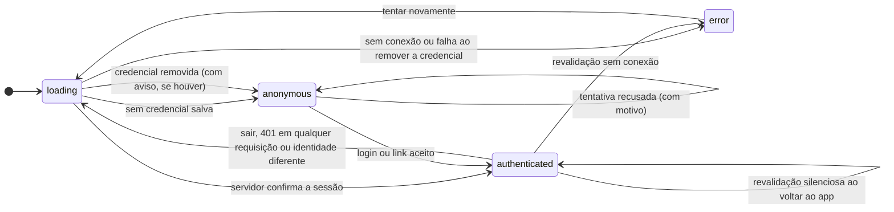
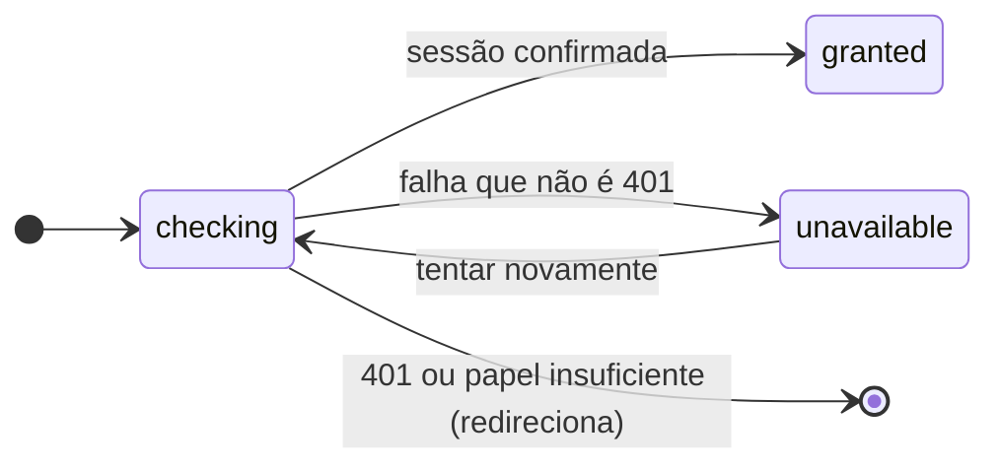
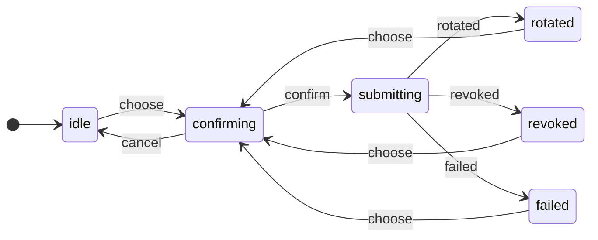
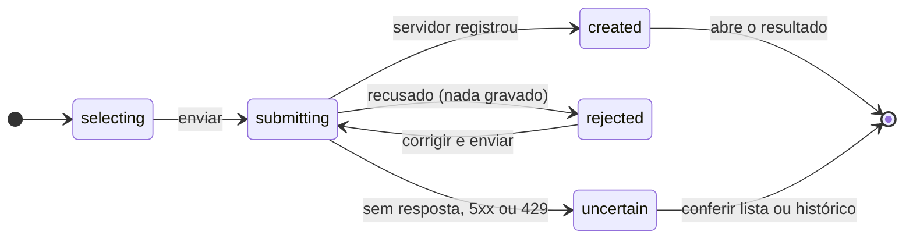

# Máquinas de estado

Atualizado em 10/11/2026.

Este documento lista todas as máquinas de estado do Futeio (web, mobile e API), diz quais estão explícitas no código e explica como escrever ou alterar uma. Serve a quem desenvolve e a agentes: antes de mexer em um fluxo de acesso, de link pessoal ou de escrita que não pode repetir, comece pela linha correspondente do catálogo.

## Decisão

Uma máquina fica **explícita** quando um estado ilegal tem custo: expor uma credencial, gravar duas vezes ou mostrar conteúdo privado sem sessão confirmada. Nesses casos:

1. O estado é uma união discriminada por `status`. Cada variante carrega só os dados que existem naquele estado (o link existe apenas em `rotated`; a sessão, apenas em `granted`/`authenticated`).
2. As transições são uma função pura `transition(state, event)` em um arquivo `*-machine.ts` ao lado do componente. Evento ignorado devolve **o mesmo objeto**.
3. O componente usa `useMachine` (`web/src/lib/machine.ts`, `mobile/src/lib/machine.ts`). `send(event)` aplica o evento na hora e devolve o novo estado, ou `null` se foi ignorado. Por isso a própria máquina é a trava contra duplo envio: não há `useRef` de bloqueio ao lado.
4. Efeitos (requisições, navegação, área de transferência) ficam no componente e reportam o resultado com outro evento.
5. As transições têm teste próprio, sem renderização. Na web, o elemento raiz expõe `data-state` para E2E e para agentes que operam a interface.

Não há biblioteca de máquinas de estado: o maior fluxo tem seis estados, e uma função pura com uma união já dá verificação exaustiva pelo compilador. Web e mobile não compartilham código de execução (ADR 0005), então `machine.ts` e `write-outcome.ts` existem nos dois clientes, com o mesmo conteúdo.

Fluxos com até três estados e sem consequência para combinações estranhas (um botão que copia, um formulário com `pending` e `erro`) continuam com `useState`. Estão no catálogo como "implícita, mantida".

## Como alterar ou criar uma máquina

- Novo estado: acrescente a variante na união. O compilador aponta os `switch` e os trechos de interface que precisam tratá-la.
- Nova transição: acrescente o evento, trate-o em `transition` e escreva o teste em `*-machine.test.*`. Estados que não aceitam o evento devolvem `state`.
- Não guarde em `useState` paralelo algo que dependa do estado da máquina (aviso, erro, link). Derive do `status` na renderização.
- Falha de escrita não idempotente: classifique com `writeFailure(error)`. `rejected` reabre o formulário; `uncertain` mantém fechado até a pessoa conferir a lista ou o histórico.

## Catálogo

### Acesso e sessão

| Máquina | Onde | Estados | Codificação |
| --- | --- | --- | --- |
| Sessão no aparelho | `mobile/src/lib/session-controller.ts` (`AuthState`) | `loading`, `anonymous`, `authenticated`, `error` | **Explícita** (união). Transições nos métodos do controlador, protegidas por `revision`. |
| Portão de sessão da web | `web/src/features/access/session-gate.ts` (`useSessionGate`) | `checking`, `unavailable`, `granted` | **Explícita**. Usada por `Administration`, `PrivateWorkspace` e `PlayersAdministration`. |
| Sessão expirada durante o uso (web) | `usePrivateError` em `private-workspace.tsx` | ativa, expirada | Implícita, mantida: derivada dos erros 401 das consultas. |
| Cobertura ao sair do primeiro plano (mobile) | `mobile/src/providers/app-providers.tsx` | visível, coberta, revalidando | Implícita, mantida: `covered` + `resumeRevision`; coberta por `native-modal-lifecycle.test.tsx`. |
| Resgate do link pessoal (web) | `web/src/features/access/player-access.tsx` | preparando, indisponível, pronto, resgatando, entrou | **Implícita, candidata**: cinco `useState` e cinco `useRef`. Ver "Pendências". |
| Login do administrador | `web/.../admin-login.tsx`, `mobile/.../login-screen.tsx` | ocioso, enviando, falhou | Implícita, mantida. |
| Sair | `administration.tsx`, `WorkspaceNavigation`, `roster-screen.tsx` | ocioso, saindo, falhou | Implícita, mantida. |

### Links pessoais (credenciais)

| Máquina | Onde | Estados | Codificação |
| --- | --- | --- | --- |
| Gerar ou revogar link (mobile) | `mobile/src/features/administration/link-access-machine.ts` | `idle`, `confirming`, `submitting`, `rotated`, `revoked`, `failed` | **Explícita**. `conceal` ao sair do primeiro plano. |
| Gerar ou revogar link (web) | `web/src/features/players/link-access-machine.ts` | os mesmos; `rotated` guarda o resultado da cópia | **Explícita**. |
| Compartilhar ou copiar um link exibido | `private-link-receipt.tsx`, `created-player-result.tsx` | ocioso, em andamento, falhou | Implícita, mantida. |

Diferenças entre os clientes, ambas intencionais: no mobile, `hide` e `conceal` mantêm `rotated` com `url: null` (o aviso de que o link anterior foi revogado continua visível); na web, `hide` volta a `idle`, e `failed` mantém a confirmação aberta para nova tentativa.

### Escritas que não podem repetir

Criar jogador e criar sorteio não são idempotentes. `writeFailure` (`web/src/lib/write-outcome.ts`, `mobile/src/lib/write-outcome.ts`) é a guarda comum: `rejected` (4xx exceto 429) ou `uncertain` (sem resposta, 5xx, 429).

| Máquina | Onde | Estados | Codificação |
| --- | --- | --- | --- |
| Criar sorteio (web) | `web/src/features/draws/draw-creation.tsx` (`DrawCreationPhase`) | `selecting`, `submitting`, `created`, `rejected`, `uncertain` | **Explícita**, derivada da mutação; exposta em `data-state`. |
| Criar sorteio (mobile) | `mobile/src/features/draws/draw-creation-screen.tsx` | os mesmos | Derivada da mutação (`isPending`, `isSuccess`, `uncertain`) + trava; sem nome de fase. |
| Cadastrar jogador (web) | `web/src/features/players/players-administration.tsx` | editando, enviando, recibo, rejeitado, incerto | Implícita, candidata: `receipt` + `mustReview` + mutação. |
| Cadastrar jogador (mobile) | `mobile/src/features/administration/player-creation-screen.tsx` | os mesmos; o recibo pode ter o link oculto | Implícita, candidata: `pending` + `blocked` + `error` + `receipt` + três `useRef`. |

### Formulários de perfil e consultas

| Máquina | Onde | Codificação |
| --- | --- | --- |
| Avaliar jogador | `web/.../profile-forms.tsx` (`RatingForm`), `mobile/.../rating-form.tsx` | Implícita, mantida: ocioso, salvando, salvo, falhou. |
| Editar nome e foto | `web/.../profile-forms.tsx` (`ProfileEditor`), `mobile/.../profile-editor.tsx` | Implícita, mantida; no mobile há ainda "confirmando remoção". |
| Listas, perfil, sorteio, foto privada | componentes com `useQuery` | Explícita pela biblioteca (`isPending`, `isError`, `data`). |

### API: ciclos de vida persistidos

A API não foi alterada. Estes ciclos são aplicados dentro de transações, com bloqueio de linha onde há corrida, e o estado é derivado de colunas de data.

| Entidade | Estados | Codificação | Transições |
| --- | --- | --- | --- |
| `AccessSession` | ativa, expirada, revogada, removida | `revokedAt`, `expiresAt` | Criada no CSRF (anônima), no login ou no resgate. Revogada ao sair, ao ser trocada por uma sessão autenticada e ao girar ou revogar o link. Removida 24 h após expirar. A condição "ativa" aparece em `session.service.ts`, `admin-login.service.ts` e `player-access.service.ts`. |
| Papel da sessão | `ANONYMOUS`, `ADMIN`, `PLAYER` | enum + colunas anuláveis | `SessionService.authenticated()` estreita para `AccessContext`. Nunca muda de papel: a sessão anterior é revogada e outra é criada. |
| `PlayerAccessCredential` | ativa, revogada | `revokedAt` | Criada no cadastro e na rotação; revogada na rotação e na revogação (`player-access.service.ts`). |
| `AdminLoginLink` | pendente, usada, revogada, expirada | `usedAt`, `revokedAt`, `expiresAt` | **Sem código**: a entrega por e-mail está adiada (`access.module.ts`). A tabela existe; nenhuma transição é executada. |
| `AuthRateLimit` | dentro do limite, bloqueado | contador por janela fixa | `rate-limit.service.ts`. |

## Pendências

- **Resgate do link pessoal na web** é a maior máquina ainda implícita. Tem duas regiões independentes (a fase do link e a requisição em andamento, que nunca pode se sobrepor a outra). A conversão deve ser feita com os testes E2E rodando.
- **Cadastro de jogador** (web e mobile) é a próxima candidata. Hoje, depois de conferir a lista, o botão volta a funcionar mas o aviso de resultado incerto continua na tela.
- **Papel insuficiente na web**: `Administration` e `PlayersAdministration` mandam um jogador autenticado para `/entrar`; as demais páginas administrativas mandam para `/jogadores`. O comportamento foi preservado em `useSessionGate` (`nonAdminPath`); unificar é decisão de produto.
- **Condição "sessão ativa" na API** está escrita em três lugares. Extrair para uma função exige rodar os testes de integração.
